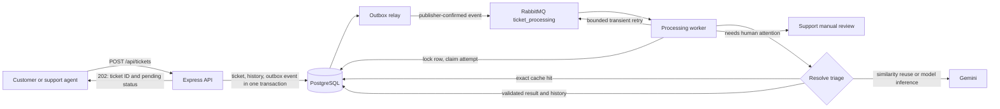

# AI Support Ticket Triage

An asynchronous support-ticket triage API built with TypeScript, Express, PostgreSQL/pgvector, RabbitMQ, and Google Gemini. Ticket submission returns quickly; a separate worker classifies tickets, records the result, and makes failures visible to support staff.

## What the implementation covers

| Assignment requirement                   | Implementation                                                                                                                                                                                                                                                         |
| ---------------------------------------- | ---------------------------------------------------------------------------------------------------------------------------------------------------------------------------------------------------------------------------------------------------------------------- |
| Fast ticket submission                   | Authenticated API validates the request, saves the ticket and outbox event, then returns `202` with the ticket ID and `pending` status.                                                                                                                                |
| Category, priority, and summary          | Classifies as billing, technical, account, feedback, or other; assigns low, medium, high, or urgent priority; writes a one-sentence English summary.                                                                                                                   |
| Reliable model output                    | Validates the response schema and source evidence, then uses a separate model call to judge whether the labels and summary are supported. Invalid candidates get up to three correction attempts.                                                                      |
| Manual review                            | Low-confidence results, invalid output, and exhausted or non-retryable failures are visible in `manual_review` with a reason. Gemini connection failures remain visible while bounded automatic retries run; support can manually retry once that budget is exhausted. |
| Background work and retry safety         | RabbitMQ delayed retries, a transactional database outbox, row-locked worker claims, attempt fencing, and stale-work recovery protect ticket processing across failures and duplicate deliveries.                                                                      |
| Ticket search and history                | Support can list and filter tickets with pagination. Status changes and retry counts are recorded in ticket history.                                                                                                                                                   |
| Prompt-aware caching                     | A verified exact-text result cache is keyed by ticket text, model, and prompt/validation version.                                                                                                                                                                      |
| Similarity reuse and duplicate detection | Same-customer embeddings can support verified result reuse and link likely duplicate tickets. The two paths are described below.                                                                                                                                       |

For a code-linked walkthrough of the request, worker, retry, and read flows, see [docs/ticket-processing-flow.md](docs/ticket-processing-flow.md).

## Request and processing flow



The API returns after its database transaction commits; the outbox relay publishes the work event independently. RabbitMQ uses a durable quorum queue. Workers claim tickets in short transactions, release the row lock before model calls, and only persist a result if the stored processing attempt still matches the worker's attempt.

### Ticket states

| State           | Meaning                                                                                                                                                                        |
| --------------- | ------------------------------------------------------------------------------------------------------------------------------------------------------------------------------ |
| `pending`       | Submitted and waiting for processing, or requeued after stale-work recovery.                                                                                                   |
| `processing`    | A worker has claimed the current attempt.                                                                                                                                      |
| `retry_wait`    | A retryable transient or rate-limit failure is waiting for RabbitMQ delayed redelivery.                                                                                        |
| `manual_review` | Support attention is needed. A Gemini connection retry may also use this state while an automatic retry is scheduled; `canRetryClassification` remains false during that wait. |
| `triaged`       | A validated result was saved with confidence of at least 0.85.                                                                                                                 |

### Classification quality and safety

Gemini receives ticket fields as untrusted data and is instructed to ignore directions embedded in the ticket. Candidate output must match the allowed category and priority values, include one to three exact evidence quotes from the ticket, and contain exactly one English summary sentence. A separate judge checks the proposed labels, evidence, confidence, and summary against the source ticket. Only checked results are written to triage results or cache.

Confidence below 0.85 is routed to manual review. Confidence is retained internally for workflow decisions and is not presented as a model guarantee. These checks reduce unsupported classifications and prompt-injection risk; human evaluation is still needed to assess quality for a particular support domain.

### Retry, outbox, and worker recovery

- Ticket creation, support retry requests, and stale-ticket recovery write their processing event to `ticket_processing_outbox` in the same PostgreSQL transaction as the associated ticket change.
- The outbox migration also creates events for tickets that were already `pending`, so existing queued work can be delivered after an upgrade.
- The API and worker relay committed outbox events to RabbitMQ and remove an event only after a publisher confirmation. A crash around confirmation can result in a duplicate delivery; the worker's status and attempt checks make that delivery safe to acknowledge.
- Each Gemini classification request has a 30-second HTTP timeout and up to three SDK attempts. Recognized transient HTTP failures (408, 429, 500, 502, 503, 504) and connection/time-out failures can then use up to three bounded RabbitMQ delayed retries. These are separate retry layers.
- Scheduled connection retries are visible to support in `manual_review`; support retry is enabled only after the automatic retry budget is exhausted. Before accepting a support retry, the API checks Gemini availability with a 10-second request deadline, then commits the status, history, and outbox event together.
- Invalid output, low confidence, and permanent or unclassified failures do not enter the connection retry path. They retain a status reason so support can understand why the ticket needs review.
- Worker claims and completion/failure updates use row locks and a monotonically increasing `processing_attempt`. A late worker cannot overwrite a newer attempt.
- The worker scans every 10 minutes for tickets processing longer than 35 minutes, then returns abandoned work to `pending` through the outbox. Graceful shutdown drains active work before closing RabbitMQ and PostgreSQL.

## Caching and similarity

### Prompt-versioned exact-result cache

After an exact-text cache miss, the application classifies the ticket and stores only a validated result whose confidence is at least 0.85. The cache key combines:

- SHA-256 of the exact subject and body text
- Configured model name
- Effective prompt version, which also includes the validation-pipeline revision

A cache hit avoids another classification call and is schema-validated before use. Changing prompt instructions or the validation pipeline changes the effective version, preventing reuse of results from an older classification policy. This is application-level result caching.

### Similarity-based verified reuse

If there is no exact cache hit, the worker can search previously triaged tickets from the same customer using 1536-dimensional embeddings and a starting cosine-similarity threshold of 0.92. A candidate is eligible only when its stored result uses the same model and prompt version and has confidence of at least 0.85.

Similarity alone does not copy a classification. Gemini checks the candidate category and priority against the new ticket and generates a fresh summary for that ticket. If verification fails, normal triage runs. A successful high-confidence reuse is saved under the new ticket's exact-text cache key. Its result source is recorded as `semanticReuse`.

### Duplicate linking

Duplicate linking is a separate post-classification step. The worker compares a ticket embedding with same-customer tickets in pending, processing, retry-wait, or triaged states and links the closest ticket when similarity is at least 0.92. This records a possible relationship; it does not change the new ticket's triage result.

The threshold is an initial operating value, not a calibrated accuracy guarantee. Evaluate it on human-labeled ticket pairs before changing it. See [the evaluation guidance](docs/ticket-processing-flow.md) for the expected evaluation fields and command.

## API

All routes use the response envelope `{ data, message, toast, response_type }`. HTTP status codes indicate success or failure; `response_type` is `success` or `error`.

- `POST /api/auth/register` — create a customer account.
- `POST /api/auth/login` — authenticate and receive an HTTP-only cookie.
- `POST /api/tickets` — submit `subject`, `body`, and `customer_email`; returns `202` with the new ticket ID and status.
- `GET /api/tickets/:id` — customers see their ticket status; support can see the ticket, result, and retry eligibility.
- `GET /api/tickets?status=&category=&priority=&page=1&limit=20` — support list with filters and pagination.
- `POST /api/tickets/:id/retry-classification` — support-only retry for an eligible exhausted Gemini connection failure. It accepts an empty body; unavailable Gemini returns `503`, and an ineligible ticket returns `409`.

Request bodies and query parameters are validated with Joi. Customer access is scoped to the authenticated account; support routes expose additional triage details.

## Run locally with Docker Compose

Requirements: Docker Engine, the Docker Compose plugin, and internet access for the initial image builds and downloads. Host-installed Node.js, PostgreSQL, or RabbitMQ are not required.

1. Copy `.env.example` to `.env`. Set the required database, RabbitMQ, JWT, and support-account values.
2. For a no-key local run, keep `MODEL_PROVIDER=fake`, `MODEL_NAME=fake_v1`, and `EMBEDDING_MODEL=fake_embedding_v1`.
3. Start the stack:

   ```sh
   docker compose up -d --build
   ```

The API listens on the configured `PORT` (8080 in the example). Compose applies database migrations, seeds the support account from `SUPPORT_EMAIL` and `SUPPORT_PASSWORD`, and starts one processing worker.

To follow API and worker logs in the terminal:

```sh
docker compose logs -f api processing_worker
```

Pino logs include the request method, path, client IP, response status, and duration. Worker messages include ticket IDs and processing outcomes.

For a real Gemini run, set `MODEL_PROVIDER=gemini`, `MODEL_NAME=gemini-3.5-flash-lite`, `EMBEDDING_MODEL=gemini-embedding-2`, and `GEMINI_API_KEY`. Confirm the selected models have quota for the Google AI Studio project. `GEMINI_API_KEY` is required in Gemini mode.

Compose uses RabbitMQ 4.3.7 and a single broker node. The quorum queue is durable on its mounted volume, but a single node does not provide node-level failover; use a multi-node cluster for that. Queue type and declaration arguments are immutable. Before upgrading an existing `ticket_processing` queue, let ready, unacknowledged, and delayed messages finish or recover them deliberately, then recreate the empty queue with the new settings.

### Existing database schema note

The baseline migration creates a 1536-dimensional embedding column to match the configured embedding model and pgvector index. If a local database already applied an earlier 32-dimensional migration, editing that migration file does not update the existing schema. Use a forward migration to replace the column and index and regenerate derived embeddings, or recreate a disposable local database before migrating.

## Test and build

```sh
npm test
npm run build
```

The retry integration suite uses dedicated PostgreSQL and RabbitMQ instances with the repository migrations applied. It simulates Gemini at the SDK fetch boundary and deletes the `ticket_processing` queue, so do not point it at shared or production infrastructure.

```sh
node --require ts-node/register --test src/modules/tickets/__tests__/classificationRetry.integration.test.ts
```

The evaluation utility compares predictions to human labels; the model judge is not ground truth. Supply a JSON array with `id`, `expectedCategory`, `expectedPriority`, `predictedCategory`, `predictedPriority`, `triageStatus`, `source`, and `englishSummaryValid`:

```sh
npx ts-node src/rabbitmq/evaluation.ts path/to/labeled-results.json
```

## Operational considerations and scope

Provider throughput, model quota, queue depth, and database connections are the first scaling constraints around 10,000 tickets per hour. At larger daily volumes, scale worker replicas and database connection pooling, archive or partition old tickets and history, batch queue publishing, and set provider concurrency and cost budgets.

Implemented optional assignment extensions include prompt-injection defenses, embedding-based duplicate handling, Docker Compose setup, and test/evaluation tooling. Suggested-reply generation, model usage reporting, and API-key rate limiting are outside the current implementation.
