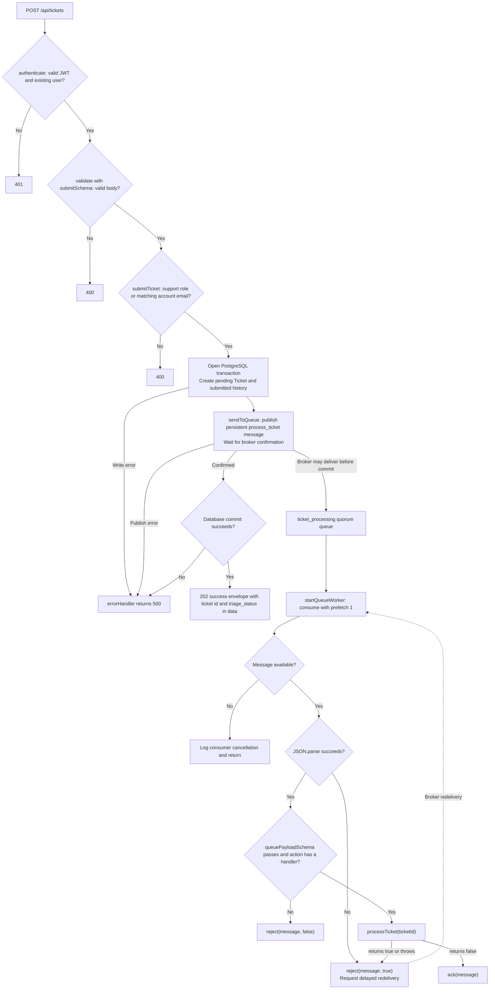
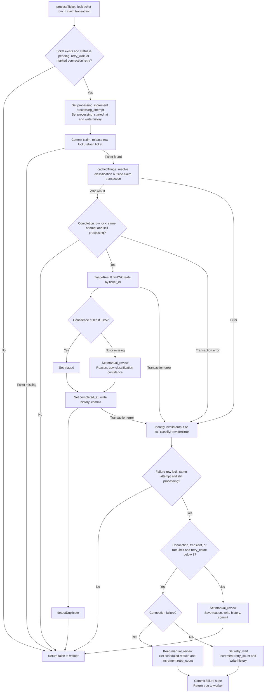
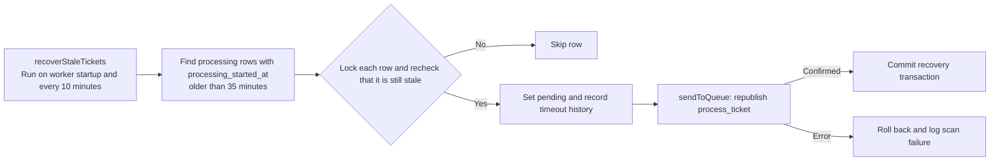
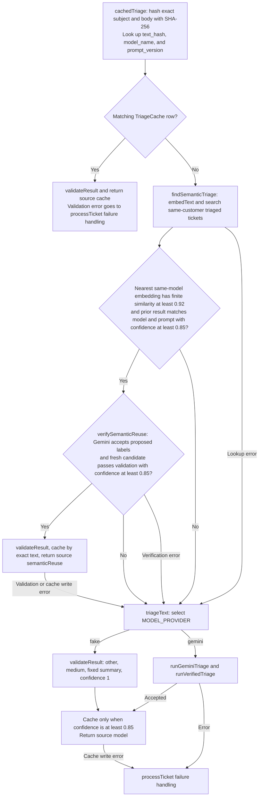
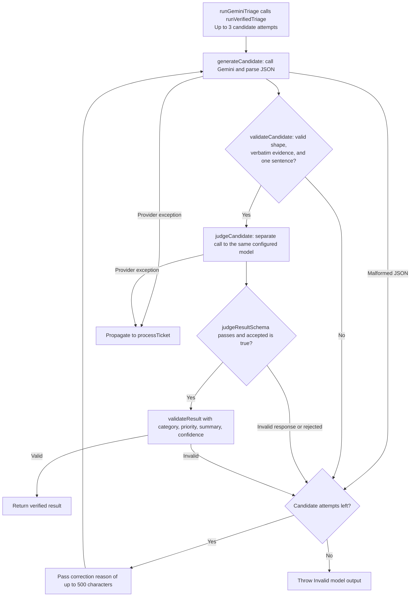
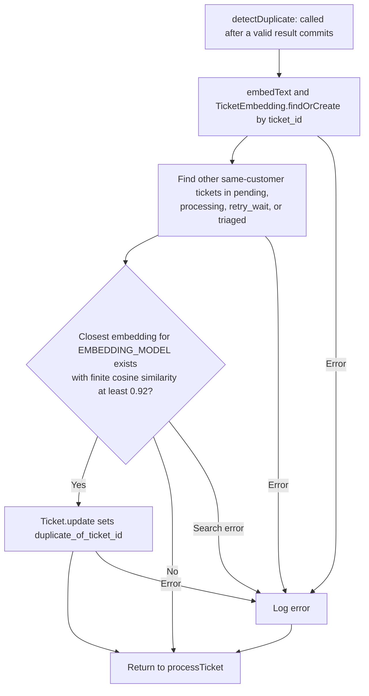

# Ticket processing flow

The Express API accepts the ticket and returns HTTP `202` once submission commits. A separate RabbitMQ worker classifies the ticket and records the outcome in PostgreSQL. The status describes the triage workflow. `manual_review` is also used while a Gemini connection retry waits in RabbitMQ; support can manually retry only after the automatic retry budget is exhausted.

All API responses use the shared `{ data, message, toast, response_type }` envelope. `response_type` is `success` for successful responses and `error` for failures; the HTTP status code remains authoritative. Error responses use an empty array for `data`.

## 1. API submission and queue delivery

| Component                                                                                                                                                    | Exact behavior                                                                                                                                                                                                                                                                                                                                                                                                                   |
| ------------------------------------------------------------------------------------------------------------------------------------------------------------ | -------------------------------------------------------------------------------------------------------------------------------------------------------------------------------------------------------------------------------------------------------------------------------------------------------------------------------------------------------------------------------------------------------------------------------- |
| [Application startup and middleware registration](../src/app.ts)                                                                                             | `start` authenticates PostgreSQL and connects to RabbitMQ. In API mode it listens on `PORT`. In worker mode it resolves `CONSUMER_TOPIC` against the configured queue names and calls `startQueueWorker`. Startup failures exit with code 1.                                                                                                                                                                                     |
| [API router](../src/router/index.ts) and [ticket router](../src/modules/tickets/router/index.ts)                                                             | The top-level router mounts tickets at `/api`. The submission route calls `authenticate`, `validate(submitSchema)`, then `submitTicket`.                                                                                                                                                                                                                                                                                         |
| [Shared middleware](../src/middleware/index.ts)                                                                                                              | `requestLog` sets `x-request-id` and logs method, path, client IP, status, and duration. `authenticate` uses the token cookie or authorization header, verifies the JWT, and loads the current user via `User.findByPk`. Missing token, invalid token, or missing account returns `401`. `validate` strips unknown body and path fields. `errorHandler` logs propagated errors and sends `500` when headers are still available. |
| [Ticket validation](../src/modules/tickets/validation-schema/index.ts)                                                                                       | `submitSchema` requires a subject of 1–255 characters, a body of 1–20,000 characters, and a valid `customer_email`.                                                                                                                                                                                                                                                                                                              |
| [Ticket controller](../src/modules/tickets/controller/index.ts)                                                                                              | `submitTicket` compares a customer's submitted email to their account email case-insensitively and saves the account email. Support can supply another email. In both cases `customer_id` is the authenticated user's ID, which also controls the scope of same-customer similarity searches. The ticket starts with `retry_count = 0` and `processing_attempt = 0`.                                                             |
| [RabbitMQ connection](../src/rabbitmq/connection.ts), [publisher](../src/rabbitmq/publisher.ts), and [queue schema](../src/rabbitmq/schemas/queue.schema.ts) | `connectRabbitMq` declares the durable quorum queue `ticket_processing` on a publisher-confirm channel. `sendToQueue` publishes `{ action: 'process_ticket', ticketId }` and waits for confirmation. `queuePayloadSchema` requires the configured action and a positive integer `ticketId` and rejects extra fields.                                                                                                             |
| [Queue worker](../src/rabbitmq/workers/worker.ts)                                                                                                            | `startQueueWorker` dispatches through `queueHandlers`. JSON parse errors and thrown handler errors reach the consumer's catch and are requeued. Parsed messages with an invalid schema or unsupported action are rejected without requeue.                                                                                                                                                                                       |

A RabbitMQ publish confirmation can precede the PostgreSQL commit. If the worker reads the ticket before it is visible, `processTicket` can return `false` and the worker acknowledges that delivery. The submission transaction rolls back when publishing throws. A database commit failure after a confirmed publish can leave a queue message with no corresponding ticket.

## 2. Ticket claim, completion, and recovery

The [processing handler](../src/rabbitmq/handlers/ticketProcessing.handler.ts) sets `last_retry_at` when it claims a ticket from `retry_wait` or the specifically marked connection-retry state. It uses `includes` for the allowed-status check. The claim, completion, and failure transactions each lock the ticket row and write transition history with the current retry count. Completion and failure also require the row to exist, the stored `processing_attempt` to match the claim, and the status to remain `processing`. A connection retry keeps `manual_review` while delayed, then the worker locks the row and changes it to `processing` before inference. The retry API rejects that scheduled reason, preventing a support-triggered run from racing with the delayed delivery. An exception during claim, reload, or failure handling can propagate to the consumer and trigger a requeue. `completed_at` remains empty while a connection retry is scheduled. Successful classification paths save the result source, model name, and prompt version.

| Transition                     | Gate and history reason                                                                                                                                                                      |
| ------------------------------ | -------------------------------------------------------------------------------------------------------------------------------------------------------------------------------------------- |
| New → `pending`                | Submission succeeds. History reason is `Ticket submitted`.                                                                                                                                   |
| `pending` → `processing`       | Worker claims the ticket. History reason is `Processing started`.                                                                                                                            |
| `retry_wait` → `processing`    | Worker claims a retry. History reason is `Retry processing started`.                                                                                                                         |
| `manual_review` → `processing` | Worker claims only when the reason is `Gemini connection retry scheduled` and the failure code is `geminiConnection`. History reason is `Retry processing started`.                          |
| `processing` → `triaged`       | Valid result with confidence ≥ 0.85. Reason is `Triage completed`.                                                                                                                           |
| `processing` → `manual_review` | Valid result with confidence below 0.85 or missing. Reason is `Low classification confidence`.                                                                                               |
| `processing` → `retry_wait`    | Retryable HTTP failure while `retry_count < 3`. Reason identifies the provider failure.                                                                                                      |
| `processing` → `manual_review` | Connection failure while `retry_count < 3` stays in manual review with reason `Gemini connection retry scheduled`; the worker requests delayed redelivery and manual retry remains disabled. |
| `processing` → `manual_review` | Non-retryable failure or exhausted retries. A connection failure uses reason `Gemini connection failed`, enabling support retry.                                                             |
| `processing` → `pending`       | Stale recovery finds the ticket still processing and older than 35 minutes. Reason is `Previous processing attempt timed out`.                                                               |

### How retries are decided

- [Gemini request options](../src/rabbitmq/triage.ts) configure a 30-second request timeout and three SDK attempts. The candidate correction loop in section 3 is a separate limit.
- [`classifyProviderError`](../src/utils/retry.ts) treats HTTP `429` as `rateLimit`, HTTP `408`, `500`, `502`, `503`, and `504` as `transient`, and the Gemini SDK's `APIConnectionError`, `APIConnectionTimeoutError`, `RequestTimeoutError`, `ConnectionError`, plus recognized socket codes as `connection`. Native `TimeoutError` values in the cause chain are also retryable; explicit abort errors are not. Connection, transient HTTP, and rate-limit failures receive up to three delayed application retries. HTTP `402` is a payment problem, `401/403` is `configuration`, and `400/404/422` is `invalidRequest`. Other errors are `unclassified`.
- [`connectRabbitMq`](../src/rabbitmq/connection.ts) configures native delayed retry of failed deliveries with a 30-second minimum and 120-second maximum. The [README retry policy](../README.md#accuracy-and-retry-policy) documents the usual 30-, 60-, and 90-second delays for three consecutive application retries. The worker uses `reject(message, true)` to request broker redelivery.

### How an abandoned claim is recovered

[`recoverStaleTickets`](../src/rabbitmq/workers/worker.ts) preserves `retry_count` and `processing_attempt` when returning a ticket to `pending`. The next claim increments `processing_attempt`. The previous delivery's completion or failure update is skipped if the status or attempt has changed.

## 3. How the worker chooses a classification

- [`cachedTriage` and `validateResult`](../src/rabbitmq/triage.ts) use a hash of `JSON.stringify([subject, body])`, with a shared cache across customers for the same model and prompt version. `resultSchema` requires a known category and priority and a 1–500 character summary. Confidence is optional and must be between 0 and 1 when present. [The configuration](../src/config/index.ts) appends `-confidence-english-v3` to the configured `PROMPT_VERSION`.
- [`findSemanticTriage`](../src/rabbitmq/handlers/ticketProcessing.handler.ts) excludes the current ticket, filters to the same `customer_id` and `triaged` status, and selects the closest stored embedding for `EMBEDDING_MODEL` by ascending pgvector cosine distance. Similarity is `1 - cosineDistance`. It checks the nearest ticket's result only.
- [`embedText`, `formatEmbeddingText`, and `verifySemanticReuse`](../src/rabbitmq/triage.ts) use the subject and body with a sentence similarity task prefix. Embeddings have 1,536 dimensions, from Gemini or a deterministic hash in fake mode. Semantic verification runs in Gemini mode and uses the old category and priority with fresh evidence, summary, and confidence for the new ticket. In fake mode the verifier returns `null`.
- [Ticket enums](../src/modules/tickets/enum/index.ts) define categories `billing`, `technical`, `account`, `feedback`, and `other`, and priorities `low`, `medium`, `high`, and `urgent`. The Gemini prompts define low as minor, medium as routine, high as blocking a core task or materially disrupting service, and urgent as requiring confirmed severe impact such as a security incident or widespread outage.

### Fresh Gemini classification

[`validateCandidate` and the judge](../src/rabbitmq/triage.ts) enforce different conditions. Candidate validation requires one to three exact evidence quotes from the subject or body, a summary ending in its only period, question mark, or exclamation point, and required confidence from 0 to 1. The prompts require an English summary and direct both calls to treat ticket text as untrusted data. The separate judge call checks whether the ticket supports the labels, confidence, evidence, and every summary claim. The [Joi schemas](../src/rabbitmq/schemas/triage.schema.ts) define the accepted response fields. Only output validation failures and judge rejection consume the local correction loop. Other exceptions propagate.

## 4. Duplicate linking after completion

[`detectDuplicate`](../src/rabbitmq/handlers/ticketProcessing.handler.ts) runs for both valid-result statuses, including low-confidence `manual_review`. It writes the duplicate reference after classification and catches its own errors. The worker acknowledges the delivery after this step.

## 5. Reading the outcome

All ticket read routes run `authenticate` before validation.

| Route and controller                                                 | Conditions and response                                                                                                                                                                                                                                                                                                                                                                                                                                                           |
| -------------------------------------------------------------------- | --------------------------------------------------------------------------------------------------------------------------------------------------------------------------------------------------------------------------------------------------------------------------------------------------------------------------------------------------------------------------------------------------------------------------------------------------------------------------------- |
| `GET /api/tickets/:id` → `getTicket`                                 | `ticketParamsSchema` requires a positive safe integer ID. Validation failure returns `400`. A missing ticket or a different owner's ticket requested by a customer returns `404`. The success envelope's `data` contains `{ id, triage_status }` for customers or `{ ticket, triage_result, canRetryClassification }` for support. The result is `null` when no result row exists.                                                                                                |
| `GET /api/tickets` → `listTickets`                                   | `validateQuery(listTicketsQuerySchema)` checks optional `status`, `category`, and `priority` against the ticket enums. Page defaults to 1 and limit defaults to 20 with a maximum of 100. Invalid or unknown query fields return `400`. Valid requests from a non-support user return `403`. The success envelope's `data` contains `{ data, page, limit, total }`, with tickets ordered newest first. Filtering by category or priority requires a matching `triage_result` row. |
| `POST /api/tickets/:id/retry-classification` → `retryClassification` | Support can retry only tickets in `manual_review` with `geminiConnection` failure code and reason `Gemini connection failed`. A scheduled connection retry has a different reason and is ineligible. The API probes Gemini before the locked state recheck. Success returns `202` with ticket ID and `pending` status in `data`. A missing ticket returns `404`, an ineligible ticket returns `409`, and unavailable Gemini returns `503`.                                        |

See the [ticket router](../src/modules/tickets/router/index.ts), [read schemas](../src/modules/tickets/validation-schema/index.ts), and [controllers](../src/modules/tickets/controller/index.ts).

## PostgreSQL models in the flow

| Model                                                                           | Stored data                                                                                             |
| ------------------------------------------------------------------------------- | ------------------------------------------------------------------------------------------------------- |
| [`User`](../src/sequelize/models/users.modal.ts)                                | Account data, including the role and email used by authentication.                                      |
| [`Ticket`](../src/sequelize/models/tickets.modal.ts)                            | Submitted text, owner, status, reason, retry and attempt counters, timestamps, and duplicate reference. |
| [`TicketStatusHistory`](../src/sequelize/models/ticket_status_history.modal.ts) | Previous and new statuses, transition reason, and retry count.                                          |
| [`TriageResult`](../src/sequelize/models/triage_results.modal.ts)               | Per-ticket classification, confidence, source, model name, and prompt version.                          |
| [`TriageCache`](../src/sequelize/models/triage_cache.modal.ts)                  | Validated outcomes keyed by the exact-text hash, model name, and prompt version.                        |
| [`TicketEmbedding`](../src/sequelize/models/ticket_embeddings.modal.ts)         | Stored ticket vector and embedding model for pgvector matching.                                         |
